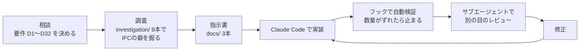

# IFCコンクリート数量算出（打設区分ごとの数量と、打設当日の残量チェック）

ゼネコンの施工管理者が、現場事務所のPCで IFC（BIM）から **「どこからどこまで打つか」ごとのコンクリート数量** を出すローカルWebアプリです。
打設当日は、タブレットで残りの数量と生コン車の台数を確かめます。

Built with Claude: Japan 2026 の応募作品です。

## なぜ作ったか

BIMの数量は「階 × 部材」で整理されていますが、現場が必要なのは「この工区の、この高さまで」の数量です。
今は Archicad で約15分かけて拾っています。専門ソフト・操作の知識・BIM用のPCが必要です。

このアプリは、工区（平面）× 高さ範囲 × 部材 で実際の形状を切って数えます。BIMソフトなしで、根拠付きで出せます（目標は約1分）。

## できること

| 画面 | できること |
|---|---|
| **PC**（`frontend/`） | IFCを開く → 施工階を選ぶ → 必要なら境界線（通り芯＋寸法、折れ線可）で工区を分ける → 打設区分ごとの数量を打設リストに積む → 表（Excel用）に書き出す |
| | 平面・3D表示、部材の色分け、数える部材と材料の選び直し、数量の根拠（重なりの控除・計算できなかった部材）の表示 |
| | 残りのスパンを選び、柱・梁の打設済み高さから、残量と生コン車の台数を出す |
| **タブレット**（`site_app/`） | PCで書き出したデータを開き、スパンをタップして打設中・打設済みにすると、残量と生コン車の台数がその場で変わる |
| | 長押しでスパンごとに高さを変える、打設の記録を残して共有する。オフラインでも動く（iPad Safari・Android Chrome） |
| **Claudeから**（MCP、`backend/mcp_server.py`） | 「5階の柱と梁だけで何㎥？」「X8〜X10 が残り、生コン車は何台？」と日本語で聞くと、同じ計算エンジンで答える |

タブレット用アプリの公開URL：https://vcr-talon.github.io/Claude_Hackathon_2026/
（アプリだけを置いています。数量のデータは含みません。データは各自のPCで書き出してタブレットに送ります）

## 数量の定義（いちばん大事なこと）

- **D1**：範囲内のコンクリート形状を、工区境界と高さで切った **重複を除いた幾何学的体積** を正とします。積算基準の数量は求めません
- **D4**：計算できない部材は推定値で補わず、「数量に入っていない部材」として理由とともに表示します
- **D5**：モデルにない増し打ち・打継ぎなどは推測で補いません
- **D20**：対象は材料名で判定します。「コンクリート」を含む材料（増し打ちを含む）が初期値で、画面で選び直せます
- 柱・梁の打設済み高さは「コン天から ○mm」で表します。入れるまでは「未計測」とし、柱・梁を全部残りに数えます（少なく見積もらない）

全決定事項（D1〜D32）は [docs/requirements.md](docs/requirements.md) にあります。

## 使い方

### 準備（初回だけ）
Windows・Python 3.12 を前提にしています。仮想環境 `.venv` を作り、そこにだけ入れます。

```bat
py -3.12 -m venv .venv
.venv\Scripts\python.exe -m pip install "ifcopenshell>=0.8" "manifold3d>=3.0" "shapely>=2.0" numpy fastapi "uvicorn[standard]" python-multipart
```

Claudeから使う（MCP）ときは `"mcp>=1.2,<2"`、テストと画面の自動確認には `pytest playwright` も入れます。

### 起動
`start.bat` をダブルクリックします。ブラウザで http://127.0.0.1:8765/ が開きます。

- フォルダに `hackathon_model.ifc` があれば起動時に読み込みます。無いときは画面の「IFCを開く」で選びます
- 【未確定】`hackathon_model.ifc` をこのリポジトリに含めるかは、公開時に決めます

### 打設当日（タブレット）
1. PCの「4. 打設終盤の残量」で、事前に「タブレット用に書き出す」を押します（ダウンロードのフォルダに保存されます）
2. そのファイルを、メールやクラウドでタブレットに送ります
3. タブレットで公開URLを開き、「データを開く」で選びます。ホーム画面に追加すると、アプリのように使えます

## 信頼性：どう確かめたか

検証の記録は [docs/verification.md](docs/verification.md) にあります。

| 確かめたこと | 基準 | 結果 |
|---|---|---|
| 単純形状（立方体・工区での切断・斜めの境界・重なり・開いた形状の除外など） | 相対誤差 1e-6 以下 | 合格（pytest） |
| 分割の整合（工区A＋B＝全体、内訳の合計＝総数量） | 0.001 m³ 以下 | 合格（実モデルで A＋B−全体 ＝ 6e-11） |
| hackathon_model.ifc の全体 | 4,377.07 m³ | 4,377.07 m³ |
| 5SL～6SL（工区A 278.53 ＋ B 94.37） | 372.90 m³ | 372.90 m³ |
| タブレットの残量 ＝ PCの数量 | 差 0.01 未満 | 372.9044 ＝ 372.9044 |
| Archicad との比較（モデル全体） | 差を要因別に説明できること | 4,428.83 対 4,377.07（−51.76 m³、−1.2%）を要因別に説明できた |

Archicad との差 −51.76 m³ の内訳：

| 要因 | 差 m³ |
|---|---|
| 材料が未設定の部材を数えない（D20） | −11.38 |
| 部材ごとの体積の差 | +7.47 |
| 計算できない部材5件を数えない（D4） | −27.00 |
| 重なりを1回だけ数える（D1） | −20.85 |

計算できない部材を含まない345の部材IDでは、3,540.11 対 3,540.06（差 −0.05 m³）でした。
工区単位（5SL～6SL 工区A）での比較は、まだ行っていません。

## Claudeとどう作ったか



| 数字 | |
|---|---|
| 決定事項 | 32件（D1〜D32） |
| 指示書 | 3本（[ui_improvements](docs/ui_improvements.md)・[site_app_spec](docs/site_app_spec.md)・[claude_setup](docs/claude_setup.md)） |
| IFCを調べたスクリプト | 8本（[investigation/](investigation/)） |
| テスト | 70件（pytest 48・node 22） |
| 画面のレビュー | 6回（site-reviewer）。指摘を直して「迷う」を減らした（[docs/reviews/](docs/reviews/)） |
| 開発日数 | 【11/8 に確定】（2026-11-02 開始） |

### Claude Code の機能の使い分け

| 機能 | 役割 | どこにあるか |
|---|---|---|
| CLAUDE.md | 数量の定義・基準値・用語・データの扱いを、毎回のセッションの前提にする | [CLAUDE.md](CLAUDE.md) |
| フック | 計算エンジンを変えたら基準値を自動で確かめ、ずれたら止める。IFCや書き出したデータをコミットさせない | [.claude/hooks/](.claude/hooks/) |
| サブエージェント | 工事主任の目で画面を見る（site-reviewer）、積算担当の目で数字だけで判定する（quantity-auditor） | [.claude/agents/](.claude/agents/) |
| スキル | 数量の検証・画面のレビュー・タブレット用書き出しの確認を、毎回同じ手順で回す | [.claude/skills/](.claude/skills/) |
| MCPサーバー | Claudeが数量を推測せず、検証済みの計算エンジンで答える | [backend/mcp_server.py](backend/mcp_server.py)・[.mcp.json](.mcp.json) |

### モデルと役割の使い分け

開発は「Claude（チャット）＝設計とレビュー」「Claude Code＝実装」の2つの場に分けました。
実装の会話を持たない別の場で設計と検証をすることで、作った本人が自分で採点しない形にしています（サブエージェントと同じ考え方）。

| 場 | モデル | 主に任せたこと | 例 |
|---|---|---|---|
| Claude（チャット） | Claude Fable 5.1 | 考え方そのものを見直す判断 | 現場目線のUI/UXレビュー、境界線の「複線方式」の設計、タブレット案を「部材ごと」から「スパンごと」に組み替えた最適化、審査基準に合わせたClaude活用の設計 |
| Claude（チャット） | Claude Opus 5.5 | 手を動かす確認と文書化 | コードの把握、実際のモデルで画面を描画しての確認（5階の平面表示の比較画像）、Archicadの一覧表との突合（差 −51.76 m³ を4要因に分解）、指示書とClaude Codeへの指示文の作成 |
| Claude Code | Claude Opus 5.5 | 実装・テスト・検証の自動化 | 計算エンジン、PC画面、タブレットアプリ、フック・サブエージェント・スキル、MCPサーバー |
| Claude Code のサブエージェント | site-reviewer：Claude Sonnet／quantity-auditor：Claude Opus | 別の目のレビュー | 画面の文言だけを見るレビューは軽いモデルで何度も回し、数字だけで合否を判定する検証は深く考えるモデルにした |

Claude Code は、開発の最初から最後まで Claude Opus 5.5 を使い、途中で切り替えていません（43件のコミットの記録すべてが Opus 5.5）。
数量を間違えられないアプリなので、速さより、計算エンジンと検証の手順を崩さないことを優先しました。

切り替えの基準は1つです。**「何を作るか・どう考えるか」を決める場面は Fable 5.1、「決めたことを確かめて形にする」場面は Opus 5.5。**
たとえばタブレットの残量チェックは、最初の案（部材を1つずつ選んで残り高さを入れる）を Fable 5.1 で見直し、現場の打ち方に合う「スパンをタップする」形に組み替えました。その指示書づくりと、実装後の動作確認は Opus 5.5 で行いました。
境目は厳密ではなく、「主に」の傾向です（Opus 5.5 でも設計の相談をした場面はあります）。

### Claudeにやらせなかったこと
- 数量の定義の変更（D1・D4・D5）と、数量を数えるかどうかの最終判断（材料が未設定の部材 11.38 m³、未計算部材 27.00 m³ の扱いなど）
- Archicadとの突合の合否の判定
- 「未確認」の項目を推測で埋めること

Claude は計算エンジンの結果だけを使い、数量を推測しません。定義や基準値に触れる変更は、必ず先に確認を求めるようにしています（[CLAUDE.md](CLAUDE.md)）。

## データの扱い

- 処理はすべて手元のPCで行い、データを外部に送りません
- IFC・キャッシュ・書き出したデータはリポジトリに入れません（フックでも止めます）
- 実案件のIFCは公開しません。外部のAIで扱うデータは、利用許可と匿名化を確認したものに限ります

## フォルダ

| フォルダ | 中身 |
|---|---|
| `backend/qto/` | 計算エンジン（IFCの読み込み、切断、重なりの控除） |
| `backend/server.py` | API とPC画面の配信 |
| `frontend/` | PC画面（Three.js） |
| `site_app/` | タブレット画面（HTML・JS・CSSのみ） |
| `investigation/` | IFCの癖を調べたスクリプトと結果 |
| `docs/` | 要件・指示書・検証の記録・レビュー |
